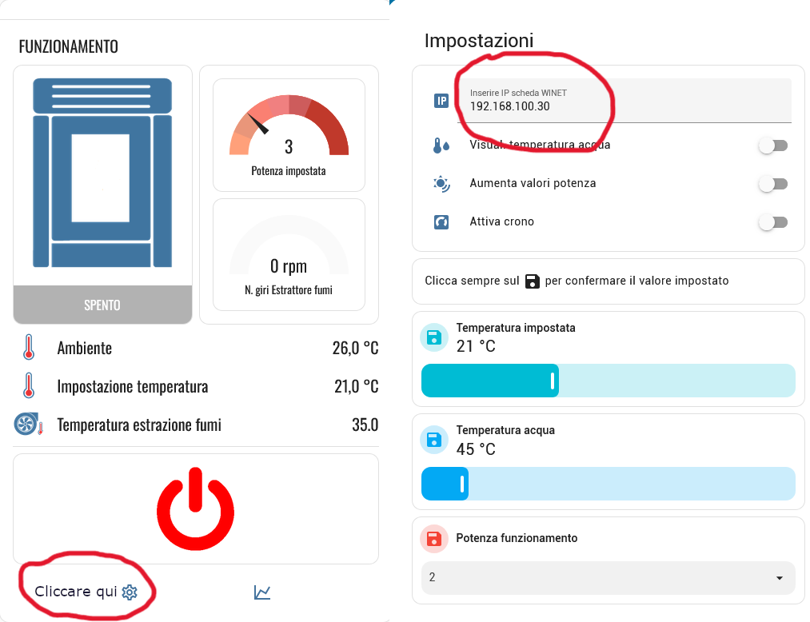
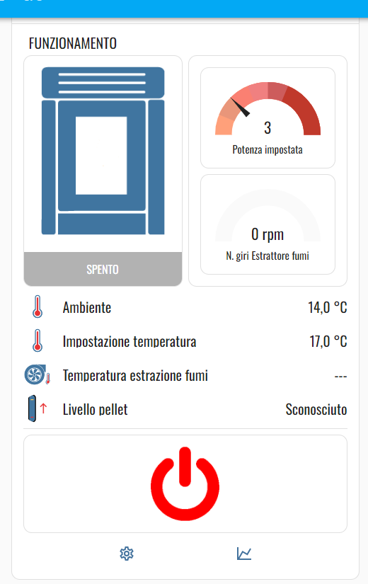
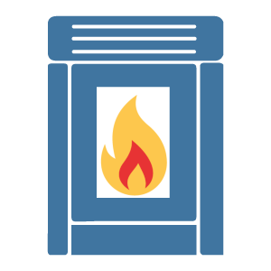
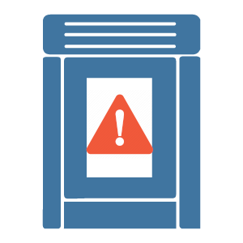
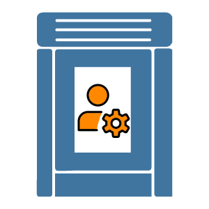
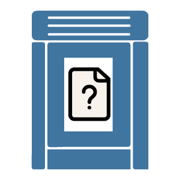
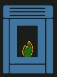

# WINET-HA - [Stufasmart](http://stufasmart.it/) -
### Package e view per i prodotti WINET (stufa da remoto)
## NOVITÀ: integrazione installabile da HACS

Ora esiste una vera **integrazione** (`custom_components/winet`) che sostituisce il package YAML: niente più `rest`, `rest_command`, `input_*` e automazioni da copiare a mano.

### Installazione con HACS
1. HACS → menu ⋮ → **Repository personalizzati** → incolla `https://github.com/morenonew2/HASS_WINET` → categoria **Integrazione**.
2. Scarica **WINET (Stufasmart)** e riavvia Home Assistant.
3. Impostazioni → Dispositivi e servizi → **Aggiungi integrazione** → *WINET*.
4. Scegli **Locale** (indirizzo IP della scheda) oppure **Cloud** (chiave API).

### Entità create
- `climate` con temperatura attuale e impostata (10–40 °C)
- `switch` accensione/spegnimento
- `number` potenza (massimo regolabile da *Configura*, 1–9) e, in locale, temperatura acqua (40–80 °C)
- `sensor`: stato, potenza, temperatura aria e impostata; in locale anche acqua, fumi, giri estrattore e descrizione stato

Gli stati della stufa (spento, acceso, attesa fiamma, stand-by, pulizia finale, pulizia braciere, allarme, non gestito) sono un sensore *enum* traducibile; per le notifiche usa una normale automazione sul cambio di stato.

La vista Lovelace in `lovelace/` e i vecchi package (`packages/`) restano per chi vuole continuare a usarli, ma **non vanno usati insieme** all'integrazione (stesse entità, nomi diversi).

---
## ATTENZIONE: package update  eliminato generic_thermostat

NEWS: AGGIUNTO PKG PER GESTIONE CON API CLOUD (SOLO WINET stufa in cloud)

UPDATE: AGGIUNTE NOTIFICHE PERSISTENTI che si possono attivare nel setup

## Installazione prerequisiti:

-	[HACS](https://www.hacs.xyz/)
  
Le seguenti integrazioni e interfacce vanno installate tramite HACS

  **INTEGRAZIONI** seguire istruzioni e poi riavviare HA
-	Browser_mod 2 (fate molta attenzione a questa installazione)
-	Scheduler
  
  **Grafica Interfaccia** dopo installazione aggiornare solo cache browser con CTRL-F5

-	Card-mod
-	Layout-card
- Paper buttons row
- Hui-element
-	Scheduler-card
-	template-entity-row


### Configurazione

Il file configuration.yaml si trova nella cartella di configurazione di Homeassistant

che, in una tipica installazione standard, si trova in:

**˂config˃ = /home/homeassistant/.homeassistant/ (p.es.  installazione tipica su Raspberry)**

****ATTENZIONE! L'INSTALLAZIONE FA FATTA A PARTIRE DALLA CARTELLA DOVE SI TROVA IL FILE CONFIGURATION.YAML****

Aggiungere le seguenti righe al proprio configuration.yaml:

```
homeassistant:
  packages: !include_dir_named packages

lovelace:
  mode: storage
  dashboards:
    lovelace-winet:
      mode: yaml
      title: WINET
      icon: mdi:fire
      show_in_sidebar: true
      filename: winet_dashboard.yaml

```
 


##### Nella cartella ˂config˃ creare  file 
winet_dashboard.yaml:
```
title: WINET
views:
  - !include lovelace/winet_view.yaml
```


### Lovelace
Nella cartella lovelace  (crearla in ˂config˃se non esiste)

Copiare file winet_view.yaml

### Pacchetti

Nella cartella packages (crearla in ˂config˃se non esiste)

Copiare file winet_pkg.yaml

### Immagini
Copiare in ˂config˃

la cartella www/Pictures/
 
### Risorse
Impostazioni > Plance > Risorse

Aggiungere 

**URL:** https://fonts.googleapis.com/css?family=Oswald

**Tipo risorsa:** foglio di stile

### Setup

Una volta creata la card impostare l'indirizzo IP della scheda e poi fate refresh delle entità REST e RESTFUL




### Supporta il mio lavoro

[](https://www.paypal.com/donate/?business=mletardi@gmail.com&item_number=Importo+suggerito:+€+2.00+EUR&currency_code=EUR)


### ScreenShot












